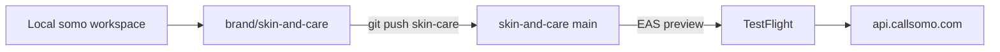

# Skin & Care — brand repo and branch workflow

**Last updated:** 2026-06-06

Skin & Care is a **consumer brand** on the shared Somo platform. Engineering lives in the Somo monorepo; the product ships from a dedicated GitHub repo.

## Repos and branches

| GitHub repo | Branch | Role |
|-------------|--------|------|
| [somo-platform](https://github.com/richiejeremiah/somo-platform) | `main` | Canonical platform — middleware deploy, B2B surfaces |
| [somo-platform](https://github.com/richiejeremiah/somo-platform) | `brand/skin-and-care` | Brand development branch (backup) |
| [skin-and-care](https://github.com/richiejeremiah/skin-and-care) | `main` | Consumer product — EAS / TestFlight / App Store |

**Runtime:** All brands share one API — `https://api.callsomo.com`.



## Day-to-day pushes

### Skin & Care app work

```bash
git checkout brand/skin-and-care
# ... edit patient-app, commit ...
npm run push:skin-care
# optional backup on somo-platform:
git push origin brand/skin-and-care
```

Or use the helper directly:

```bash
node scripts/push-brand-remote.cjs skin-and-care
```

### Platform / middleware work

```bash
git checkout main
# ... edit middleware-platform, commit ...
git push origin main
```

Middleware staging deploy runs from **somo-platform `main` only** (`.github/workflows/deploy-staging.yml`). The skin-and-care repo does **not** redeploy Cloud Run.

## Merge cadence (platform → brand)

Pull platform fixes into the brand branch regularly so the app stays compatible with `api.callsomo.com`:

```bash
git checkout brand/skin-and-care
git fetch origin
git merge origin/main
# resolve conflicts (usually middleware-platform/, rarely patient-app/)
npm run push:skin-care
```

**Recommended:** weekly, or before every TestFlight / App Store release.

## CI on skin-and-care repo

| Workflow | Trigger | What it does |
|----------|---------|--------------|
| `skin-care-mobile.yml` | push to `main` (patient-app paths) | Typecheck, care_program tests, EAS preview build |
| `ci.yml` | push/PR to `main` | Full platform CI (brand guard uses `BRAND_PROFILE=skin-and-care` on mobile workflow) |

Set `EXPO_TOKEN` in **skin-and-care** repo → Settings → Secrets for automated EAS builds.

## Local development

```bash
cd patient-app
cp .env.example .env   # EXPO_PUBLIC_API_BASE_URL=https://api.callsomo.com
npx expo start
```

Physical device / TestFlight builds use EAS profiles in `patient-app/eas.json`.

## Manual launch checklist

See [`todos/pending/IOS_SKINCARE_TRACKER_LAUNCH_TODOS.md`](../../todos/pending/IOS_SKINCARE_TRACKER_LAUNCH_TODOS.md).

## Multi-brand template (future)

Repeat for each consumer brand:

1. `git checkout -b brand/<name>` from `main`
2. Rebrand `patient-app/app.json` (name, bundle ID), `eas.json`, env
3. `gh repo create <org>/<name> --private`
4. `git remote add <name> https://github.com/<org>/<name>.git`
5. Add entry to `scripts/push-brand-remote.cjs`
6. `git push <name> brand/<name>:main`
7. Add `STRIPE_PRICE_<PRODUCT>` on shared middleware production env
8. Add `.github/workflows/<name>-mobile.yml` (copy skin-care-mobile.yml)

Consumer brands differ by **bundle ID**, **Stripe product**, and **copy** — not by separate API deployments.

## EAS first build (one-time)

```bash
cd patient-app
npx eas login
npx eas build:configure   # if project not linked
npx eas build --platform ios --profile preview
```

After App Store Connect app exists, fill `eas.json` submit credentials and run:

```bash
npx eas submit --platform ios --profile production --latest
```
